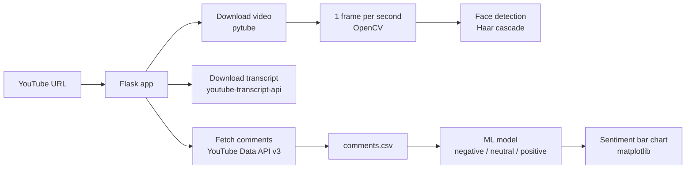

# YouTube Sentiment Analysis

A Flask web app that analyses the audience response to a YouTube video. Paste a video link and the app downloads the video, its transcript and all of its comments, classifies every comment as **positive, neutral or negative** with a trained machine-learning model, and shows the result as a chart.

Built as my **B.E. Computer Engineering final year project** at Amrutvahini College of Engineering (Savitribai Phule Pune University), 2024.


## Features

- **Comment sentiment:** fetches every top-level comment through the YouTube Data API v3 (following all result pages) and classifies each one as negative, neutral or positive.
- **Results chart:** plots how many comments fall into each sentiment class.
- **Transcript download:** saves the video's captions as plain text.
- **Video processing:** downloads the video in its highest resolution and extracts one frame per second with OpenCV.
- **Face detection:** finds the frames that contain faces using OpenCV's Haar cascade classifier and saves them separately.

## How it works



## Tech stack

| Area | Technology |
|---|---|
| Web app | Python, Flask |
| Data collection | YouTube Data API v3 (google-api-python-client), pytube, youtube-transcript-api |
| Sentiment analysis | Trained ML text classifier (pickle), pandas |
| Video processing | OpenCV (frame extraction, Haar cascade face detection) |
| Visualisation | matplotlib |

## Output

Everything for a video is saved in a folder named after its video ID:

```
<output_path>/<video_id>/
├── video.mp4
├── transcription.txt
├── comments.csv
├── frames/                # one frame per second
└── frames_with_faces/     # frames where a face was detected
```

## Getting started

### Prerequisites

- Python 3.10 or newer
- A YouTube Data API v3 key ([Google Cloud Console](https://console.cloud.google.com/) → enable **YouTube Data API v3** → create an API key)

### 1. Install

```bash
git clone https://github.com/shaileshjj368/Youtube-Sentiment-Analysis.git
cd Youtube-Sentiment-Analysis
python -m venv venv
venv\Scripts\activate           # macOS/Linux: source venv/bin/activate
pip install flask pandas matplotlib opencv-python google-api-python-client pytube "youtube-transcript-api<1.0"
```

### 2. Configure

1. **API key:** set the `YOUTUBE_API_KEY` environment variable. Never commit the key to the repository.
   ```bash
   set YOUTUBE_API_KEY=your_key_here          # Windows
   export YOUTUBE_API_KEY=your_key_here       # macOS/Linux
   ```
2. **Output folder:** in `app.py`, set `output_path` in the `/url` route to the folder where downloads should be saved.
3. **Model:** place the trained model file `sentiment_analysis_model.pkl` in the project root. It must take a table of comments and predict one of three classes: negative, neutral or positive.

### 3. Run

```bash
python app.py
```

Open `http://127.0.0.1:5000`, paste a YouTube video URL and submit. When processing finishes, the sentiment chart opens and the page shows **Completed!!**.

## Project structure

```
Youtube-Sentiment-Analysis/
├── app.py                         # Flask routes and the full processing pipeline
├── templates/
│   └── dashboard.html             # page with the URL form
└── sentiment_analysis_model.pkl   # trained sentiment model
```

## Author

**Shailesh Joshi**
[LinkedIn](https://www.linkedin.com/in/shaileshjoshi368) · [GitHub](https://github.com/shaileshjj368)
